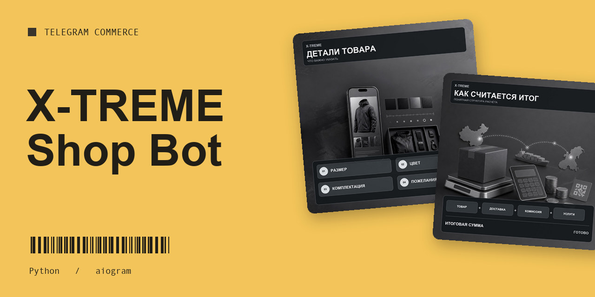
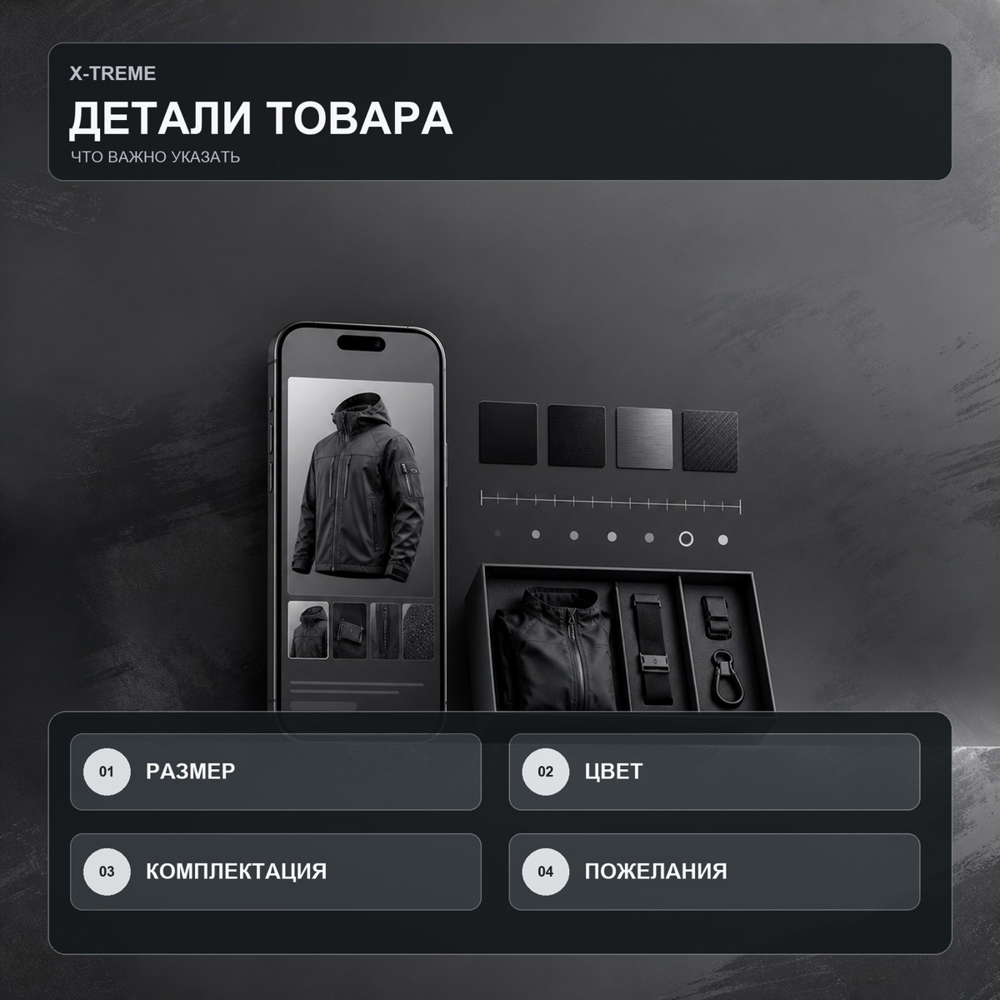
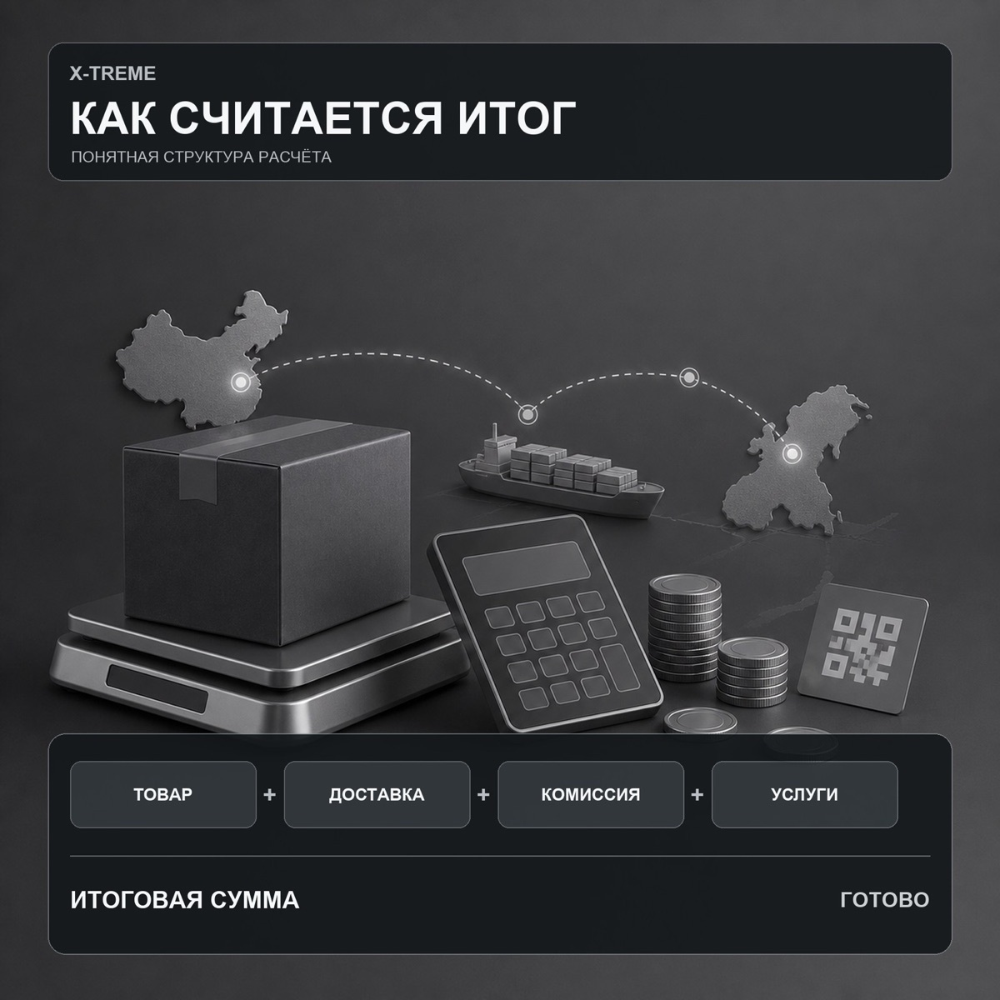

<a href="README.md"><picture><source media="(max-width: 600px)" srcset="https://raw.githubusercontent.com/mrjakeball/mrjakeball/main/assets/navigation/ru-on-compact.svg?v=2"></picture></a>
<a href="README_EN.md"><picture><source media="(max-width: 600px)" srcset="https://raw.githubusercontent.com/mrjakeball/mrjakeball/main/assets/navigation/en-off-compact.svg?v=2"></picture></a>
<a href="https://github.com/mrjakeball/portfolio"><picture><source media="(max-width: 600px)" srcset="https://raw.githubusercontent.com/mrjakeball/mrjakeball/main/assets/navigation/catalog-ru-compact.svg?v=2"></picture></a>

# X-TREME Shop Bot

Бот оформляет заявку на покупку с Poizon или Taobao. Покупатель передаёт ссылки и параметры товаров, видит предварительный расчёт и подтверждает состав заказа перед передачей оператору.

Опубликован в Telegram · Публичная витрина приватного проекта  
Python 3.11 · aiogram 3 · SQLite · Pillow

## Как заявка доходит до оператора

1. **Товар.** Бот собирает ссылку, характеристики и при необходимости изображения. В одну заявку можно добавить несколько товаров.
2. **Расчёт.** Клиент видит доставку и комиссии до подтверждения. Бот формирует временную PNG-сводку.
3. **Передача.** Оператор получает структурированную заявку. Состояния диалога организованы через FSM, данные хранятся в SQLite. Для проверки целостности QR-ссылок используется HMAC.

В галерее опубликованы инструкции бота. Проект независим от торговых площадок.

## Что видит покупатель до подтверждения

**[Детали товара](assets/screen-details.jpg)** · Инструкция показывает, какие сведения приложить к ссылке. Это помогает оператору различать варианты одного товара.

**[Как считается итог](assets/screen-calculation.jpg)** · Вторая памятка объясняет составляющие предварительной суммы. Её можно открыть отдельно и сверить расчёт до передачи заявки.

Развернуть галерею

[Примечание о проекте](NOTICE.md) · [Профиль](https://github.com/mrjakeball) · [Каталог проектов](https://github.com/mrjakeball/portfolio)
