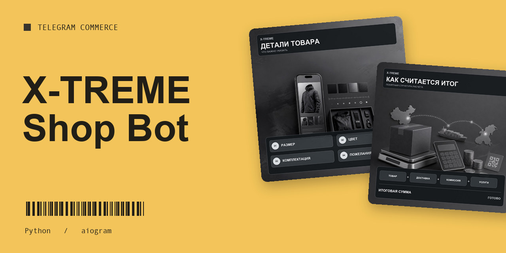
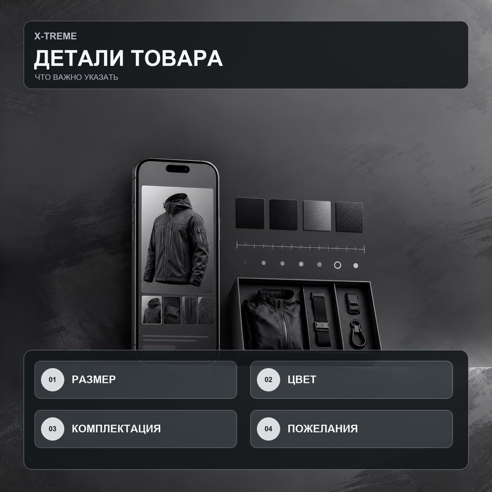

# X-TREME Shop Bot

A Telegram bot for Poizon and Taobao purchase requests. A customer submits product links and options, reviews an estimate and confirms the order before an operator receives it.

[Open the bot ↗](https://t.me/XtremeShopBot)

Published on Telegram · Public showcase of a private project  
Python 3.11 · aiogram 3 · SQLite · Pillow

## From product link to operator

1. **Item details.** The bot collects a link, product options and optional images. Multiple items can belong to one request.
2. **Estimate.** The customer reviews shipping and fees. The bot prepares a temporary PNG summary.
3. **Handoff.** The operator receives a structured request. An FSM tracks conversation steps, SQLite stores state, and an HMAC authenticates QR-link data.

The gallery reproduces the bot’s public instruction sheets. This is an independent project.

## What the buyer can review before confirming

**[Item details](assets/screen-details.jpg)** · The guide shows what to include with the product link so the operator can distinguish between variants of the same item.

**[How the estimate works](assets/screen-calculation.jpg)** · The second sheet explains the parts of the estimate. Open it at full size to review the calculation before the request reaches the operator.

View the gallery

[Project notice](NOTICE.md) · [Profile](https://github.com/mrjakeball/mrjakeball/blob/main/README_EN.md) · [Project catalogue](https://github.com/mrjakeball/portfolio/blob/main/README_EN.md)
